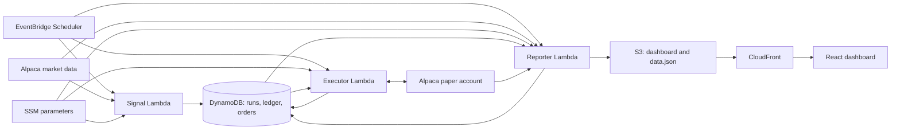

# Paper Ledger · Serverless Trading Bot

[](https://github.com/asanuri2005/trading-bot/actions/workflows/ci.yml)

A Python research and paper-trading system with a React dashboard. It compares seven strategy books, runs scheduled workloads on AWS, and reconciles a combined portfolio with Alpaca's paper brokerage.

**[View the deployed dashboard](https://d3vpu1cg2par0x.cloudfront.net/)** · [How it works](GUIDE.md) · [Accounting and execution design](REVIEW_CHANGES.md)

The engineering focus is reproducible comparisons and reliable execution: cash-inclusive returns, immutable daily records, retry-safe order submission, and a clear separation between simulated performance and broker fills. This is a personal research project; the results do not establish an advantage over buy-and-hold.

## Try it without accounts

The local dashboard includes an explicitly labeled, synthetic sample. No AWS or Alpaca credentials are needed.

```bash
git clone https://github.com/asanuri2005/trading-bot.git
cd trading-bot
npm ci --prefix dashboard
npm run dev --prefix dashboard
```

Open **http://localhost:5173/?sample=1** (or the port Vite prints). Sample prices, allocations, and balances are fictional; the chart is not a strategy backtest. The deployed dashboard uses daily published snapshots, not a streaming market feed.

## Architecture



**Stack:** Python 3.12 on Lambda, pandas/NumPy, DynamoDB, SSM Parameter Store, EventBridge Scheduler, S3/CloudFront, AWS SAM, React, Vite, and Recharts. Research tools also run on Python 3.11. CI tests both Python versions and builds the dashboard with Node.js 22.

On normal market days, the signal function runs at **15:40**, the executor at **15:45**, and the reporter at **17:15**, all in `America/New_York`. Signals use completed prior-session data. Holidays are checked against Alpaca's calendar; the executor skips early-close sessions when its schedule falls after the close.

## Strategy comparison

Each simulated book starts with **$12,000**, includes idle cash in equity, and models **5 basis points per side** in transaction costs. All seven use the same experiment universe and start date.

| Book | Decision rule |
| --- | --- |
| TSMOM 6mo | Absolute momentum over 126 trading days |
| RSI-2 + 200d | Short-term mean reversion with a long-term trend filter |
| ML LogReg | Frozen logistic-regression model using price-derived features |
| Rotation top-3 | Cross-sectional momentum ranking |
| Dual momentum | Momentum ranking plus an absolute-momentum filter |
| Ensemble 2-of-3 | Agreement between two of three component signals |
| Buy & hold | Equal-weight initial investment held as a reference |

The six active strategies also contribute targets to **one combined Alpaca paper portfolio**. Buy-and-hold is a simulated reference only. The seven cards are not seven separately executed brokerage accounts.

## Reliability and accounting

- **Cash counts.** Return is total equity divided by the initial budget minus one. Inactive allocations remain cash. Sells precede buys, and simulated purchases include costs in their cash limit.
- **A complete day or no update.** A single immutable `RUN` contains the signal batch, and a single immutable `LEDGER` contains all seven valuations. Missing inputs stop publication rather than partially advancing the comparison.
- **Retries preserve decisions.** Stable client order IDs, saved execution plans, broker reconciliation, and a DynamoDB lease protect against duplicate submissions and overlapping invocations.
- **Fills remain distinct from targets.** The reporter refreshes delayed fills. Order records are keyed by broker order ID so changing update timestamps do not create duplicate dashboard rows.
- **Experiments are explicit.** The universe, budget, costs, lineup, and model hash are frozen per experiment. A changed configuration needs a new experiment ID; old records remain available.
- **Paper execution only.** New deployments default to `DryRun=true`, and the executor rejects the live-money endpoint. The existing demonstration deployment has paper execution enabled.

See [the implementation review](REVIEW_CHANGES.md) and [dated paper-launch checks](PAPER_READINESS.md) for details and limitations.

## Run the research and checks

Install Python 3.11 or 3.12 and Node.js 22. From the repository root:

```bash
python -m venv .venv
```

Activate with `.venv\Scripts\Activate.ps1` in Windows PowerShell, or `source .venv/bin/activate` on macOS/Linux. Then:

```bash
python -m pip install -r requirements-dev.txt
python -m unittest discover -s tests -v
npm ci --prefix dashboard
node --test dashboard/src/metrics.test.js
npm run build --prefix dashboard
```

An offline portfolio comparison uses the bundled historical files:

```bash
python portfolio_backtest.py --csv data/orcl-1995-2014.txt data/nvda-1999-2014.txt --strategy dualmom --eval-start 2012-01-01 --outdir output/demo
```

The command writes comparison results under `output/demo`. Those older data files are useful for exercising the pipeline; they are not evidence about current trading performance. Online symbol downloads use yfinance and require network access.

To train an experimental ML candidate without replacing the frozen model:

```bash
python ml_train.py --csv data/orcl-1995-2014.txt data/nvda-1999-2014.txt --out models/candidates/logreg.json
```

Training uses walk-forward evaluation and exports candidate artifacts separately. Compare common evaluation dates, costs, drawdowns, and prediction coverage before considering promotion. Candidate promotion is manual; training does not deploy a model.

## Repository map

| Path | Purpose |
| --- | --- |
| `strategies.py` | Shared strategy rules and ML features |
| `portfolio_backtest.py` | Cash-inclusive multi-asset comparisons |
| `backtest.py`, `compare.py` | Single-asset research and strategy comparisons |
| `ml_train.py`, `models/logreg.json` | Walk-forward training and the frozen inference artifact |
| `aws/template.yaml` | Infrastructure as code and schedule configuration |
| `aws/src/` | Signal, execution, reporting, and shared accounting/state code |
| `dashboard/` | React dashboard and synthetic sample |
| `tests/` | Accounting, research, and broker regression tests |
| `.github/workflows/ci.yml` | Automated tests, artifact checks, and frontend build |
| `watchlist.txt` | Local ticker universe; publishing it is an explicit operation |

`make sync` copies the shared strategy code and frozen model into the Lambda package. CI checks that the copies match. On Windows, the Make targets require Git Bash and GNU Make; the individual Python/npm commands above work without Make.

## Deploy your own instance

See [GUIDE.md](GUIDE.md) for the deployment sequence. AWS and Alpaca accounts are only needed to operate a separate hosted instance. Store credentials in SSM SecureString parameters; local environment files, SAM configuration, generated output, and candidate models are excluded from Git.

GitHub Actions runs tests and builds only. Deployment is manual and no AWS or Alpaca secrets are required by CI.

## Interpretation and limits

Shadow books use fractional synthetic units, adjusted closes, and compounding equity. Paper execution uses whole shares, fixed strategy budgets, recent trade prices, and actual paper fills. Those differences mean broker returns will not exactly match the simulated charts. Cash has no modeled interest, and the executor is not a full settlement-aware cash ledger.

Historical prices can be revised, the watchlist is manually selected, and research choices can overfit. A short paper run tests operations more readily than investment quality. Broader out-of-sample evaluation and longer monitoring remain future work. Real-money execution is not enabled by this repository.

[Archived early notes](docs/HISTORICAL_NOTES.md) preserve the project's earlier design and reported experiments. Their older configuration and performance conclusions are historical, not current validation.
